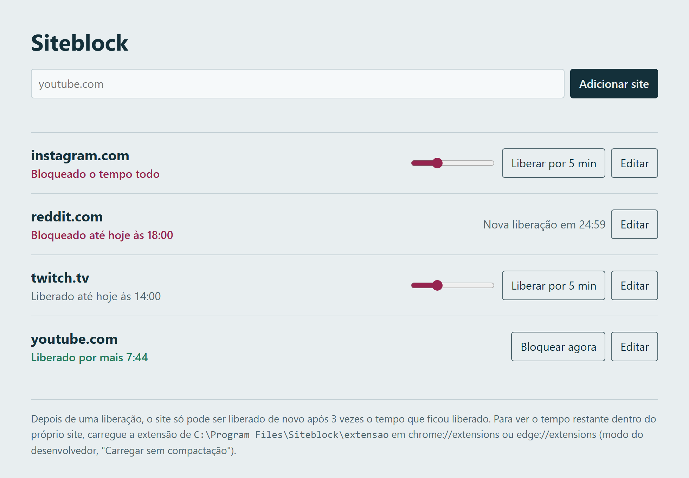
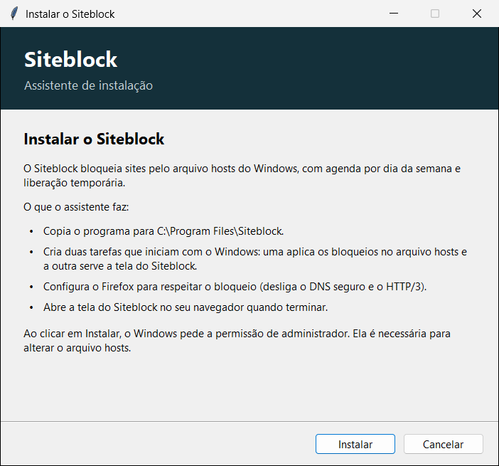
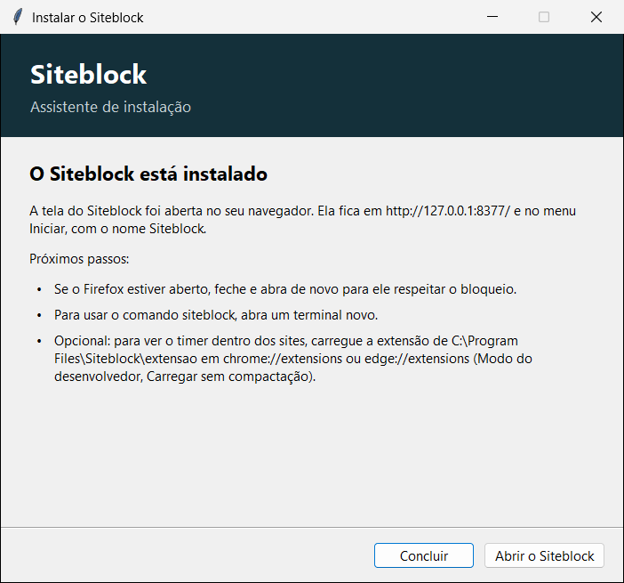
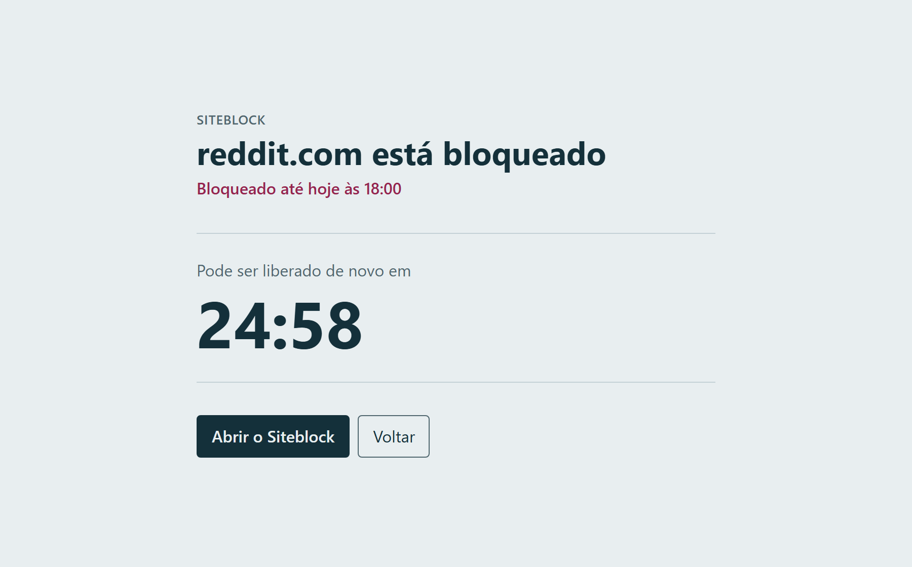
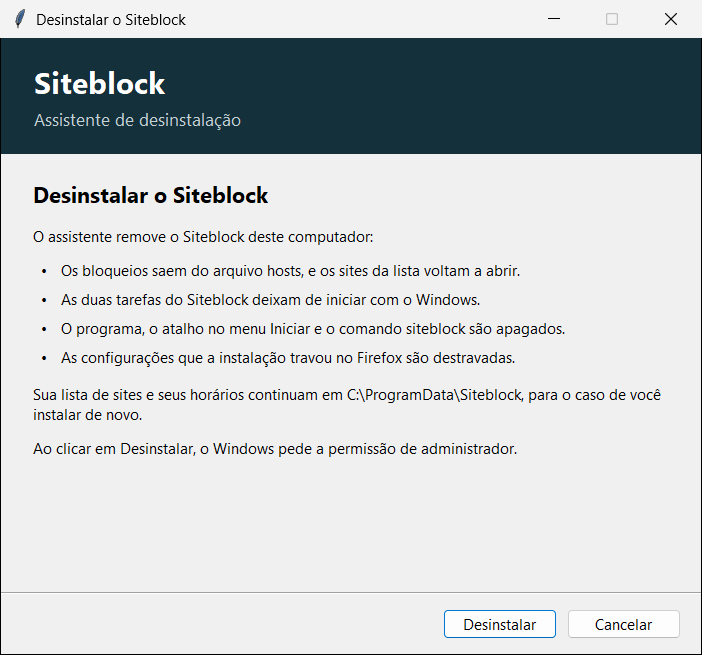
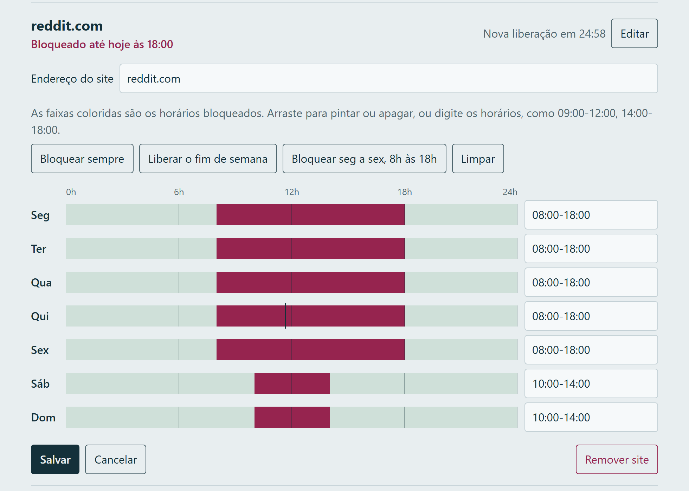

# Siteblock

Bloqueia sites no Linux e no Windows pelo arquivo hosts do sistema, com agenda por dia da semana e liberação temporária de 1 a 15 minutos. Tudo roda localmente: uma interface no navegador (`http://127.0.0.1:8377`) e um comando `siteblock` no terminal.



É um arquivo só, [siteblock.py](siteblock.py), sem dependências além do Python. O mesmo arquivo serve para os dois sistemas: ele reconhece onde está rodando e usa o mecanismo certo para bloquear. No Windows, o [instalar.cmd](windows-installer/instalar.cmd) só abre o assistente de instalação que está dentro do `siteblock.py`. O logo, [logo-block-site.jpg](logo-block-site.jpg), é opcional: se estiver na mesma pasta na hora da instalação, vira o ícone da aba (e, no Linux, do atalho no menu).

## O que ele faz

- **Lista de sites**: adicionar, trocar o endereço e remover. Dá pra colar uma URL inteira; ele extrai só o domínio.
- **Agenda semanal**: para cada dia, os intervalos em que o site fica **bloqueado**. Por exemplo, bloqueado de segunda a sexta das 09:00 às 18:00 e livre no fim de semana. Na interface você arrasta na barra do dia ou digita os horários.
- **Liberar por X minutos**: libera o site por 1 a 15 minutos, mesmo dentro de um horário bloqueado. Depois o bloqueio volta sozinho.
- **Espera entre liberações**: depois de uma liberação, o site só pode ser liberado de novo após 3 vezes o tempo que ficou liberado. Liberou por 10 minutos, espera 30 minutos depois que a liberação acabar. Se você encerrar antes, vale o tempo que realmente usou: encerrou com 2 minutos, espera 6. Enquanto isso, o botão de liberar some e no lugar aparece quanto falta.
- **Bloquear agora**: encerra a liberação na hora e derruba as conexões que já estavam abertas com o site. Se a agenda já deixa o site livre naquele horário, o botão aparece como "Encerrar liberação".
- **Extensão do navegador (opcional)**: mostra uma janelinha no canto do site com quanto falta para ele ser bloqueado e, no lugar da tela "Não é possível acessar esse site", uma página dizendo que o site está bloqueado e em quanto tempo pode ser liberado de novo.

## Requisitos

**Linux**

- Distro com systemd
- Python 3.10 ou mais novo
- `ss` (pacote `iproute2`, já vem na maioria das distros)

**Windows**

- Windows 10 ou 11
- Python 3.10 ou mais novo, de [python.org](https://www.python.org/downloads/). O Python da Microsoft Store não serve, porque as tarefas do Windows não conseguem usá-lo. Se faltar, o assistente de instalação oferece baixar e instalar. Para instalar por conta própria, marque no instalador **Add python.exe to PATH** e, de preferência, **Install for all users**.

## Instalação

A instalação mexe no arquivo hosts e cria serviços que iniciam com o PC, então **precisa de permissão de administrador**. No Windows, o assistente pede essa permissão sozinho; pelo terminal, o comando para e avisa se ela faltar.

### Linux

No terminal, na pasta onde está o `siteblock.py`, a partir do seu usuário (não logado como root), use `sudo`:

```bash
sudo python3 siteblock.py install
```

### Windows

**Pelo instalador.** Baixe o [Siteblock-Instalador.exe](https://github.com/jooguilhermesc/site_block/releases/latest/download/Siteblock-Instalador.exe), da [última versão publicada](https://github.com/jooguilhermesc/site_block/releases/latest), e dê um duplo clique. Não precisa baixar mais nada: ele já traz o `siteblock.py`, o `instalar.cmd` e o logo, e abre o assistente descrito logo abaixo.

O arquivo não tem assinatura digital, então o Windows pode mostrar o aviso **O Windows protegeu o computador**. Clique em **Mais informações** e em **Executar assim mesmo**.

**Pelo assistente, a partir dos arquivos do projeto.** Dê um duplo clique em `instalar.cmd`, na pasta `windows-installer`. Ele procura o `siteblock.py` na própria pasta e na pasta de cima.

1. A janela do assistente mostra o que vai ser feito. Clique em **Instalar**.
2. O Windows pede a permissão de administrador. Confirme.
3. Quando a instalação termina, a tela do Siteblock abre no seu navegador padrão.



Ao terminar, o assistente mostra os próximos passos. **Abrir o Siteblock** abre a tela de novo e **Concluir** fecha a janela.



Antes de abrir a janela, o `instalar.cmd` (aberto por você ou pelo instalador) verifica se o computador tem um Python que sirva. Se não tiver, ele pergunta se pode instalar. Com um **Sim**:

- baixa o instalador do Python de python.org (cerca de 35 MB);
- confere se o arquivo está assinado pela Python Software Foundation, e só então o executa;
- instala para todos os usuários, e por isso o Windows pede a permissão de administrador;
- abre o assistente do Siteblock.

Com um **Não**, nada é baixado nem instalado. A versão instalada é a da linha `set "PYVER=..."`, no começo do `instalar.cmd`.

Pelo terminal, `python siteblock.py setup` abre o mesmo assistente, sem precisar de terminal como administrador.

Abra o assistente **a partir da sua própria conta do Windows**. A interface fica ligada à conta que abriu o assistente, mesmo que a permissão seja dada com a senha de outra conta.

**Pelo terminal.** Dá no mesmo, sem a janela:

1. Abra o menu Iniciar e digite **Terminal** (ou **PowerShell**).
2. Clique com o botão direito e escolha **Executar como administrador**. Confirme o aviso do Windows.
3. Vá até a pasta onde está o `siteblock.py` e rode a instalação:

```powershell
cd C:\caminho\da\pasta
python siteblock.py install
```

Se o comando `python` não for encontrado, use `py siteblock.py install`.

Por esse caminho, a interface fica ligada à conta que abriu o terminal como administrador.

**Firefox no Windows.** Por conta própria, o Firefox escapa do bloqueio no Windows: ele pode usar DNS seguro, guarda os endereços em cache e mantém conexões por QUIC e IPv6, que o Windows não deixa derrubar. Por isso, a instalação configura o Firefox por política do sistema:

- desliga o DNS seguro;
- desliga o HTTP/3;
- faz o Firefox usar só IPv4;
- desliga o cache de DNS próprio dele.

Essas opções ficam travadas: aparecem em cinza nas configurações, e `about:policies` lista as políticas ativas. Feche e abra o Firefox depois de instalar. O `uninstall` remove tudo isso. No Chrome e no Edge o bloqueio já funciona sem nada disso.

### Depois de instalar

Abra `http://127.0.0.1:8377` ou procure **Siteblock** no menu de aplicativos (Linux) ou no menu Iniciar (Windows). Os serviços iniciam sozinhos com o PC. No Windows, o comando `siteblock` passa a funcionar nos terminais abertos depois da instalação.

### Extensão do navegador

O hosts bloqueia antes de o navegador chegar a qualquer página, então só uma extensão consegue mostrar o timer. A instalação grava a extensão em:

| Sistema | Pasta |
|---|---|
| Linux | `/usr/local/share/siteblock/extensao` |
| Windows | `C:\Program Files\Siteblock\extensao` |

Para carregar no Chrome, Chromium ou Edge:

1. Abra `chrome://extensions` (no Edge, `edge://extensions`).
2. Ligue o **Modo do desenvolvedor**.
3. Clique em **Carregar sem compactação** e escolha a pasta da tabela acima.

Com ela, em um site da lista:

- **Liberado, com bloqueio marcado para daqui a até 1 hora**: aparece uma janelinha no canto inferior direito com o tempo restante. Ela fica vermelha no último minuto e um clique a deixa menor. Quando o tempo acaba, a aba vai para a página de bloqueio.

  

- **Bloqueado**: em vez do erro do navegador, aparece uma página com o motivo e, se houver espera, em quanto tempo o site pode ser liberado de novo. Quando o site é liberado, a página volta sozinha para o endereço que você tentou abrir.

  

A extensão só lê o estado em `127.0.0.1:8377`; ela não libera nem bloqueia nada. O bloqueio continua no hosts, com ou sem ela. Ao atualizar o Siteblock, clique no botão de recarregar no cartão da extensão.

Para gravar a extensão em outra pasta: `siteblock extension ~/siteblock-extensao`.

> **Antes de usar:** apague do hosts as linhas de bloqueio que você colocou à mão (`/etc/hosts` no Linux, `C:\Windows\System32\drivers\etc\hosts` no Windows). Enquanto elas estiverem lá, o site continua bloqueado mesmo quando a agenda libera. A interface avisa quando encontra esse conflito.

### Atualizar

Baixe o `siteblock.py` novo (no Windows, pode ser o `Siteblock-Instalador.exe` novo) e instale de novo do mesmo jeito: pelo instalador, pelo assistente ou pelo comando de instalação, como administrador. Sua lista e seus horários são mantidos.

### Desinstalar

Também precisa de administrador.

Linux:

```bash
sudo siteblock uninstall
```

Windows, pelo assistente: abra **Configurações > Aplicativos > Aplicativos instalados**, procure **Siteblock** e escolha **Desinstalar**. O assistente mostra o que vai ser removido e pede a permissão de administrador. Outros dois caminhos levam à mesma janela: o botão **Desinstalar** que aparece ao abrir o `instalar.cmd` com o Siteblock já instalado, e o comando `siteblock setup --uninstall`.



Windows, pelo terminal aberto como administrador:

```powershell
siteblock uninstall
```

Isso remove os serviços, o atalho, o comando `siteblock`, a extensão, o bloco do Siteblock no hosts e, no Windows, as políticas do Firefox e a entrada nos aplicativos instalados. Remova também a extensão na página de extensões do navegador. A lista e uma cópia do hosts original continuam no sistema:

| Sistema | Lista | Cópia do hosts |
|---|---|---|
| Linux | `/var/lib/siteblock/` | `/etc/hosts.siteblock.bak` |
| Windows | `C:\ProgramData\Siteblock\` | `C:\Windows\System32\drivers\etc\hosts.siteblock.bak` |

## Uso pela interface

Abra `http://127.0.0.1:8377` ou o atalho **Siteblock**. A tela é uma lista com uma linha por site.


### Adicionar um site

Digite o endereço no campo do topo e clique em **Adicionar site** (ou aperte Enter). Dá pra colar a URL inteira. O site entra na lista **bloqueado o tempo todo**; para escolher os horários, veja [Definir os horários](#definir-os-horários).

### Ler o estado de cada site

Embaixo do endereço fica o estado atual. Na imagem acima:

| Site | Estado | O que quer dizer |
|---|---|---|
| `instagram.com` | Bloqueado o tempo todo | A agenda bloqueia o site em todos os horários. |
| `reddit.com` | Bloqueado até hoje às 18:00 | Está num horário bloqueado, que termina às 18:00. À direita, **Nova liberação em 24:59** é a espera depois de uma liberação. |
| `twitch.tv` | Liberado até hoje às 14:00 | Está fora dos horários bloqueados; o próximo começa às 14:00. |
| `youtube.com` | Liberado por mais 7:44 | Foi liberado por alguns minutos, e o bloqueio volta quando o contador zerar. |

### Liberar por alguns minutos

1. Na linha do site, arraste o controle deslizante para escolher de 1 a 15 minutos. O botão ao lado mostra o valor escolhido.
2. Clique em **Liberar por N min**. O estado passa a ser **Liberado por mais…**, com um contador.
3. Para encerrar antes do fim, clique em **Bloquear agora**. Se a agenda já deixa o site livre naquele horário, o botão aparece como **Encerrar liberação**.

Quando a liberação acaba, o controle e o botão dão lugar a **Nova liberação em…**, com o tempo que falta para você poder liberar o site de novo. Eles voltam quando essa espera termina.

### Definir os horários

Clique em **Editar** na linha do site. As faixas coloridas são os horários **bloqueados** de cada dia.



- **Arrastar na barra do dia** pinta ou apaga horários, de 15 em 15 minutos. Se você começar num trecho livre, pinta; se começar num trecho bloqueado, apaga.
- **Digitar no campo à direita** também funciona: `08:00-18:00`, ou mais de um intervalo separado por vírgula, como `09:00-12:00, 14:00-18:00`. Campo vazio é dia livre.
- **Atalhos** preenchem a semana inteira de uma vez: **Bloquear sempre**, **Liberar o fim de semana** (bloqueia de segunda a sexta o dia todo), **Bloquear seg a sex, 8h às 18h** e **Limpar** (nenhum horário bloqueado).
- O risco vertical na barra de hoje marca a hora atual.
- **Endereço do site** troca o domínio sem perder a agenda.

Nada muda até você clicar em **Salvar**. **Cancelar** fecha o editor sem alterar a agenda, e **Remover site** tira o site da lista depois de uma confirmação.

## Uso pelo terminal

Tudo o que a interface faz também está disponível na linha de comando. Nenhum destes comandos precisa de `sudo` nem de terminal como administrador.

```bash
siteblock list                      # mostra cada site e o estado atual
siteblock add youtube.com reddit.com # adiciona (bloqueados o tempo todo)
siteblock edit reddit.com old.reddit.com
siteblock rm reddit.com
siteblock unblock youtube.com 10    # libera por 10 minutos (1 a 15), se não estiver na espera
siteblock block youtube.com         # encerra a liberação
siteblock extension PASTA           # grava a extensão do navegador em PASTA
```

### Agenda

`siteblock schedule DOMÍNIO DIAS=HORÁRIOS ...` define os horários **bloqueados**:

```bash
# bloqueado em horário comercial durante a semana, livre no fim de semana
siteblock schedule youtube.com seg-sex=09:00-18:00 sab,dom=livre

# dois intervalos no mesmo dia
siteblock schedule reddit.com seg-sex=08:00-12:00,13:00-18:00

# bloqueado o dia inteiro na quarta
siteblock schedule instagram.com qua=tudo
```

- Dias: `seg`, `ter`, `qua`, `qui`, `sex`, `sab`, `dom`. Aceita faixas (`seg-sex`) e listas (`sab,dom`).
- Horários: `HH:MM-HH:MM`. Use `livre` para nenhum bloqueio no dia e `tudo` para o dia inteiro.
- Dias não citados mantêm a agenda que já tinham.
- Para atravessar a meia-noite, divida em dois dias: `sex=22:00-24:00 sab=00:00-02:00`.

## Como funciona

São dois processos, separados de propósito. No Linux são serviços do systemd; no Windows, tarefas do Agendador de Tarefas com os mesmos nomes.

| Processo | Roda como | O que faz |
|---|---|---|
| `siteblock-enforcer` | root (Linux) / SYSTEM (Windows) | A cada 2 segundos lê a agenda e reescreve o bloco do Siteblock no hosts. Quando um site passa a ficar bloqueado, derruba as conexões abertas com ele (`ss -K` no Linux, `SetTcpEntry` no Windows). Não abre nenhuma porta. |
| `siteblock-ui` | seu usuário | Serve a interface em `127.0.0.1:8377`. Só edita o arquivo de configuração e nunca toca no hosts. |

No Windows, o enforcer inicia com o PC e a interface quando você entra na sua conta. Se alguma das duas parar, o Agendador a abre de novo em até 5 minutos.

O Siteblock só mexe no trecho entre estas marcas do hosts; o resto do arquivo fica como está:

```
# >>> siteblock (gerenciado automaticamente, não edite este bloco)
...
# <<< siteblock
```

A configuração fica em `config.json`, na pasta da lista (tabela em [Desinstalar](#desinstalar)). Se ela estiver inválida, o enforcer mantém o hosts como está, em vez de liberar tudo.

## Limitações

- **Subdomínios**: bloqueia o domínio, `www.` e `m.`. Outros subdomínios, como `music.youtube.com`, precisam ser adicionados à parte, porque o hosts não aceita curinga.
- **Conteúdo de outros domínios**: só caem as conexões com o domínio listado. Um vídeo já aberto que vem de uma CDN pode continuar tocando até você bloquear esse domínio também.
- **Sites no mesmo servidor**: ao derrubar conexões, outro site que use o mesmo IP perde a conexão por um instante e reconecta sozinho. Uma chamada de vídeo nesse servidor pode cair brevemente.
- **Conexões já abertas no Windows**: o Windows só permite derrubar conexões TCP por IPv4. Conexões por IPv6 ou QUIC já abertas continuam até o navegador reconectar; com a extensão, a aba vai para a página de bloqueio do mesmo jeito.
- **Antivírus no Windows**: alguns antivírus vigiam o hosts e podem bloquear a gravação ou avisar que ele foi alterado. Se o bloqueio não for aplicado, veja o log do enforcer (em [Problemas](#problemas)).
- **DNS seguro (DoH)**: se o navegador usar DNS seguro, ele pode ignorar o hosts. No Windows, a instalação já desliga o DNS seguro do Firefox; no Linux, desligue à mão nas configurações do navegador se o bloqueio não pegar.
- **Autocontrole, não cadeado**: a lista é editável pelo seu usuário sem administrador. Mudar a agenda ou remover e adicionar o site de novo contorna a espera entre liberações. Serve para segurar o impulso, não para impedir quem quer burlar.
- **Extensão**: só funciona no Chrome, no Chromium e no Edge, e só no navegador onde estiver carregada. Em outros navegadores o bloqueio funciona igual, mas aparece a tela de erro comum.

## Problemas

**O site continua abrindo depois de bloqueado.**
Veja o log do enforcer, que registra quando não consegue gravar o hosts ou derrubar uma conexão:

```bash
journalctl -u siteblock-enforcer -n 20                          # Linux
Get-Content "C:\Program Files\Siteblock\enforcer.log" -Tail 20  # Windows (PowerShell)
```

Confira também se não sobrou uma linha manual no hosts ou se o navegador está usando DNS seguro.

**A interface não abre.**

Linux:

```bash
systemctl status siteblock-ui
```

Windows: veja se as tarefas estão rodando e, se não estiverem, inicie-as num terminal como administrador. Os erros da interface ficam em `C:\ProgramData\Siteblock\interface.log`.

```powershell
schtasks /Query /TN siteblock-ui
schtasks /Run /TN siteblock-ui
schtasks /Run /TN siteblock-enforcer
```

**O assistente parou com erro.**
A janela mostra o que a instalação ou a desinstalação informou. O mesmo texto fica em `C:\Program Files\Siteblock\instalacao.log`.

## Variáveis de ambiente

Úteis para testes, sem precisar mexer no sistema real:

| Variável | Padrão no Linux | Padrão no Windows |
|---|---|---|
| `SITEBLOCK_DIR` | `/var/lib/siteblock` | `C:\ProgramData\Siteblock` |
| `SITEBLOCK_HOSTS` | `/etc/hosts` | `C:\Windows\System32\drivers\etc\hosts` |
| `SITEBLOCK_PORT` | `8377` | `8377` |

## Publicar uma versão

O `Siteblock-Instalador.exe` é gerado pelo GitHub Actions, em [release.yml](.github/workflows/release.yml). Para publicar uma versão, crie e envie uma tag no formato `v1.2.3`:

```bash
git tag v1.2.3
git push origin v1.2.3
```

O workflow gera o instalador com essa versão e cria a release com o arquivo anexado e as notas montadas a partir dos commits. Rodando o workflow à mão, pela aba **Actions**, ele só gera o instalador e o deixa nos artefatos da execução, sem publicar nada.

Para gerar o instalador no seu Windows, sem instalar nada além do que o sistema já tem:

```powershell
powershell -ExecutionPolicy Bypass -File windows-installer\build.ps1 -Version 1.2.3
```

O arquivo sai em `dist\Siteblock-Instalador.exe`. Ele é o [launcher.cs](windows-installer/launcher.cs) com o `siteblock.py`, o `instalar.cmd` e o logo embutidos: ao abrir, grava os três em `%TEMP%\Siteblock-instalador` e roda o `instalar.cmd`.

## Alternativas

Se preferir algo pronto (informações das páginas dos projetos, não testadas aqui):

- **LeechBlock NG**: extensão de navegador com agenda e liberação temporária. Vale só no navegador onde estiver instalada.
- **WebTimeout**: extensão do Firefox com agenda por dia e horário.
- **Censor**: bloqueia no sistema todo por dia e horário, sem liberação temporária.
- **Open Turkey**: feito para ser difícil de burlar. Linha de comando com systemd.

## Licença

Distribuído sob a [licença MIT](LICENSE).
